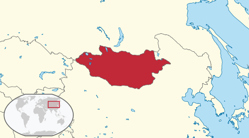
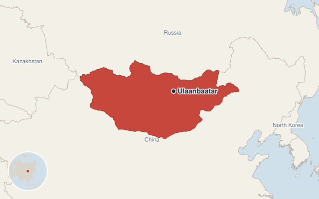

---
id    = "33dfa5db-ebce-5d90-b5ea-96c679b34bbb"
model = "Basic"
tags  = ["asia", "sovereign_state", "map"]
---

## Front

What is highlighted on this map?

## Back

<b>Mongolia</b>

## Extra

<i>Photo: The original uploader was Adagio at English Wikipedia. (Original text: Adagio), CC BY-SA 3.0, via Wikimedia Commons</i>

Landlocked between Russia and China 1.56 million km², the second largest landlocked country

Grassy steppe covers much of it, with mountains to the north and west and the Gobi Desert to the south.

<a href="https://en.wikipedia.org/wiki/Mongolia">Mongolia on Wikipedia</a>
