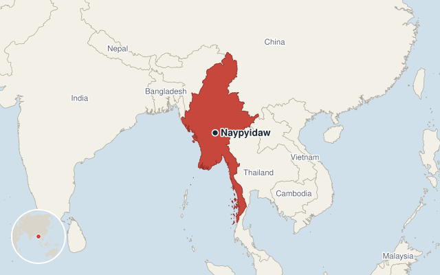

---
id    = "b539458d-36e4-5318-b5e9-a20a30e35588"
model = "Basic"
tags  = ["asia", "southeast_asia", "sovereign_state", "capital"]
---

## Front

What is the capital of <b>Myanmar</b>?

## Back

<b>Naypyidaw</b>

## Extra

Also known as Burma.

<a href="https://en.wikipedia.org/wiki/Naypyidaw">Naypyidaw on Wikipedia</a> <a href="https://en.wikipedia.org/wiki/Myanmar">Myanmar on Wikipedia</a>
