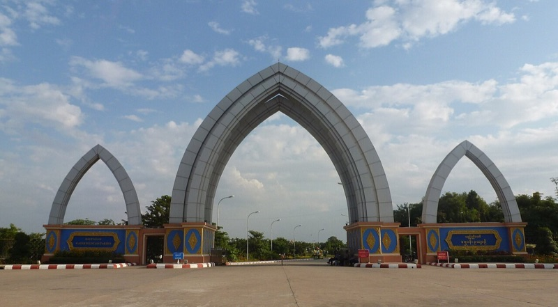

---
id    = "b539458d-36e4-5318-b5e9-a20a30e35588"
model = "Basic"
tags  = ["asia", "southeast_asia", "sovereign_state", "capital"]
---

## Front

What is the capital of <b>Myanmar</b>?

## Back

<b>Naypyidaw</b>

## Extra

<i>Photo: Hybernator, CC BY-SA 3.0, via Wikimedia Commons</i>

Covers 7,054 km², with a very low population density Built from 2002 on a greenfield site, about 320 km north of Yangon

It replaced Yangon as the administrative capital on 6 November 2005. Its name, Burmese for "abode of the king", was made public on Armed Forces Day, 27 March 2006.

Also known as Burma.

<a href="https://en.wikipedia.org/wiki/Naypyidaw">Naypyidaw on Wikipedia</a> <a href="https://en.wikipedia.org/wiki/Myanmar">Myanmar on Wikipedia</a>
