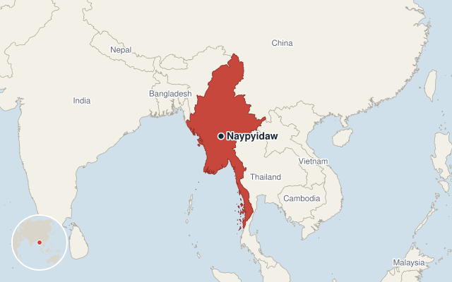

---
id    = "73c6938f-1b70-544b-ac38-bee00ac53fa6"
model = "Basic"
tags  = ["asia", "southeast_asia", "sovereign_state", "country"]
---

## Front

<b>Naypyidaw</b> is the capital of which country or territory?

## Back

<b>Myanmar</b>

## Extra

Also known as Burma.

<a href="https://en.wikipedia.org/wiki/Myanmar">Myanmar on Wikipedia</a> <a href="https://en.wikipedia.org/wiki/Naypyidaw">Naypyidaw on Wikipedia</a>
