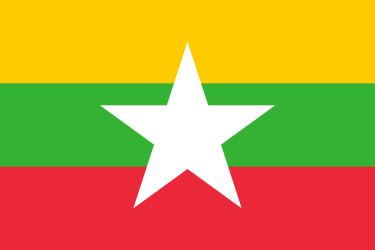
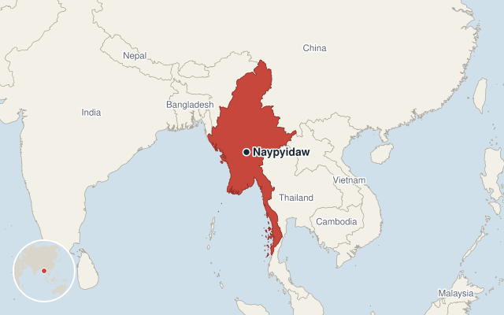

---
id    = "641d9e7b-96eb-56f9-8ecc-0cb673e80206"
model = "Basic"
tags  = ["asia", "southeast_asia", "sovereign_state", "flag"]
---

## Front

Whose flag is this?

## Back

<b>Myanmar</b>

## Extra

Also known as Burma.

<a href="https://en.wikipedia.org/wiki/Flag_of_Myanmar">Flag of Myanmar on Wikipedia</a> <a href="https://en.wikipedia.org/wiki/Myanmar">Myanmar on Wikipedia</a>
