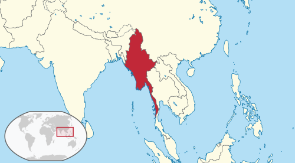
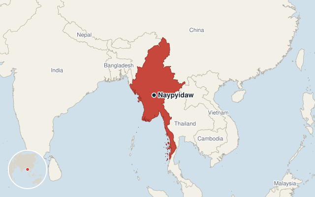

---
id    = "03c75bb2-f81e-5d77-944d-0b3bed12e2d4"
model = "Basic"
tags  = ["asia", "southeast_asia", "sovereign_state", "map"]
---

## Front

What is highlighted on this map?

## Back

<b>Myanmar</b>

## Extra

Also known as Burma.

<a href="https://en.wikipedia.org/wiki/Myanmar">Myanmar on Wikipedia</a>
