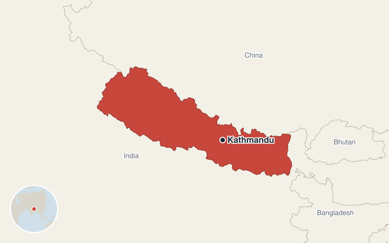

---
id    = "70390573-c162-545e-9134-ddf71b70641e"
model = "Basic"
tags  = ["asia", "sovereign_state", "capital"]
---

## Front

What is the capital of <b>Nepal</b>?

## Back

<b>Kathmandu</b>

## Extra

About 846,000 people (2021 census) 1,324 m above sea level, in the Kathmandu Valley

The name comes from Kasthamandap, a public pavilion: in Sanskrit, kāṣṭha means "wood" and maṇḍapa "pavilion". Legend says all the timber for it came from a single tree.

<a href="https://en.wikipedia.org/wiki/Kathmandu">Kathmandu on Wikipedia</a> <a href="https://en.wikipedia.org/wiki/Nepal">Nepal on Wikipedia</a>
