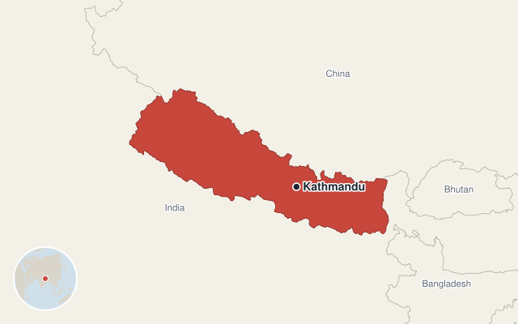

---
id    = "da38c9e2-f742-5d65-9085-fa9fac29c3db"
model = "Basic"
tags  = ["asia", "sovereign_state", "country"]
---

## Front

<b>Kathmandu</b> is the capital of which country or territory?

## Back

<b>Nepal</b>

## Extra

<a href="https://en.wikipedia.org/wiki/Nepal">Nepal on Wikipedia</a> <a href="https://en.wikipedia.org/wiki/Kathmandu">Kathmandu on Wikipedia</a>
