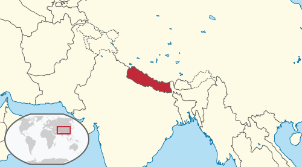
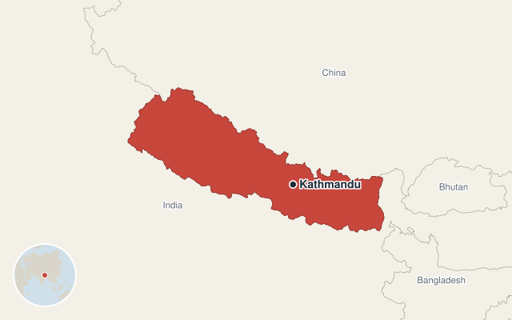

---
id    = "b1e9bef1-0f0f-5b22-b38f-a57e214f36aa"
model = "Basic"
tags  = ["asia", "sovereign_state", "map"]
---

## Front

What is highlighted on this map?

## Back

<b>Nepal</b>

## Extra

Borders China to the north and India to the south, east and west

Mostly Himalayas, with part of the Indo-Gangetic Plain in the south. It holds eight of the world's ten highest mountains, including Mount Everest.

<a href="https://en.wikipedia.org/wiki/Nepal">Nepal on Wikipedia</a>
