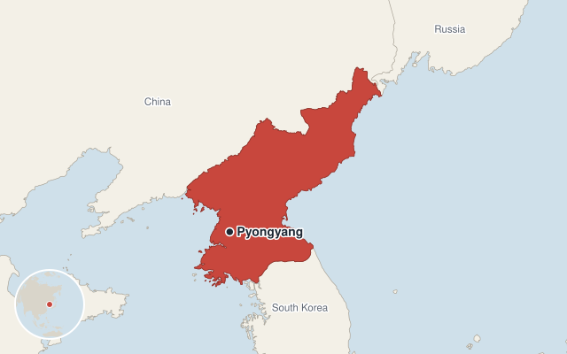

---
id    = "703a7873-04de-5197-b889-e2e55c8c20e3"
model = "Basic"
tags  = ["asia", "sovereign_state", "capital"]
---

## Front

What is the capital of <b>North Korea</b>?

## Back

<b>Pyongyang</b>

## Extra

About 3.26 million people (2008 census) On the Taedong River, 109 km upstream from the Yellow Sea

One of the oldest cities in Korea: according to legend it was founded in 1122 BC. The name joins the Sino-Korean words for "flat" and "land".

<a href="https://en.wikipedia.org/wiki/Pyongyang">Pyongyang on Wikipedia</a> <a href="https://en.wikipedia.org/wiki/North_Korea">North Korea on Wikipedia</a>
