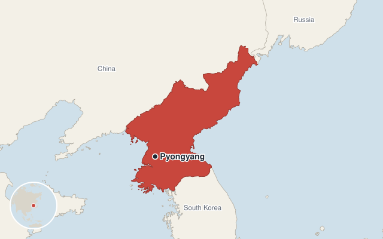

---
id    = "43626d7a-660e-5f03-a62b-1dede60e33cd"
model = "Basic"
tags  = ["asia", "sovereign_state", "country"]
---

## Front

<b>Pyongyang</b> is the capital of which country or territory?

## Back

<b>North Korea</b>

## Extra

<a href="https://en.wikipedia.org/wiki/North_Korea">North Korea on Wikipedia</a> <a href="https://en.wikipedia.org/wiki/Pyongyang">Pyongyang on Wikipedia</a>
