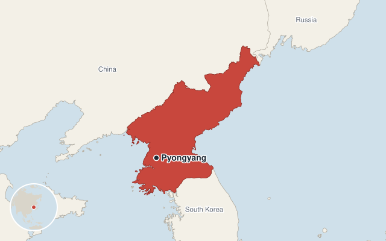

---
id    = "74f5b15b-786c-5686-b3ad-d7d7959b5c21"
model = "Basic"
tags  = ["asia", "sovereign_state", "map"]
---

## Front

What is highlighted on this map?

## Back

<b>North Korea</b>

## Extra

<a href="https://en.wikipedia.org/wiki/North_Korea">North Korea on Wikipedia</a>
