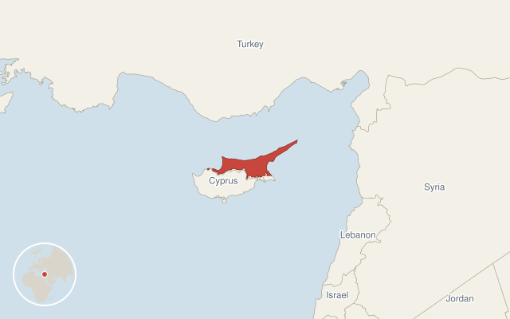
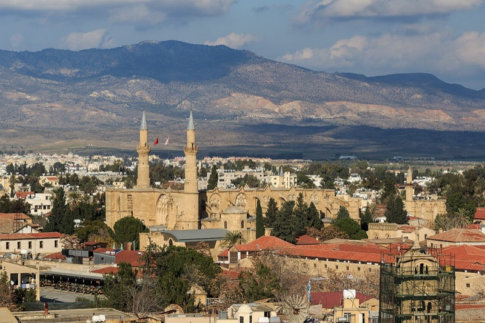

---
id    = "8d7fe697-4169-58c5-894e-d385a7e37791"
model = "Basic"
tags  = ["asia", "mediterranean", "middle_east", "sovereign_state", "capital"]
---

## Front

What is the capital of <b>Northern Cyprus</b>?

## Back

<b>North Nicosia</b>

## Extra

<i>Photo: A.Savin, FAL, via Wikimedia Commons</i>

About 61,000 people (2011), the largest settlement in Northern Cyprus The northern part of the divided city of Nicosia

Nicosia was divided into Greek and Turkish Cypriot quarters by the Green Line, named for the colour of the pen a United Nations officer used to draw it on a map.

State recognised only by Turkey and claimed by Cyprus.

<a href="https://en.wikipedia.org/wiki/North_Nicosia">North Nicosia on Wikipedia</a> <a href="https://en.wikipedia.org/wiki/Northern_Cyprus">Northern Cyprus on Wikipedia</a>
