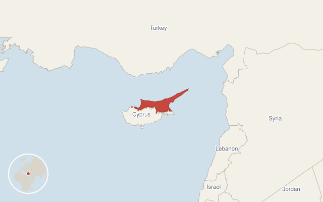

---
id    = "b11cfc7f-3e09-507d-b38b-22a17656b8ad"
model = "Basic"
tags  = ["asia", "mediterranean", "middle_east", "sovereign_state", "country"]
---

## Front

<b>North Nicosia</b> is the capital of which country or territory?

## Back

<b>Northern Cyprus</b>

## Extra

State recognised only by Turkey and claimed by Cyprus.

<a href="https://en.wikipedia.org/wiki/Northern_Cyprus">Northern Cyprus on Wikipedia</a> <a href="https://en.wikipedia.org/wiki/North_Nicosia">North Nicosia on Wikipedia</a>
