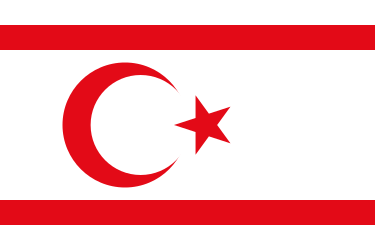
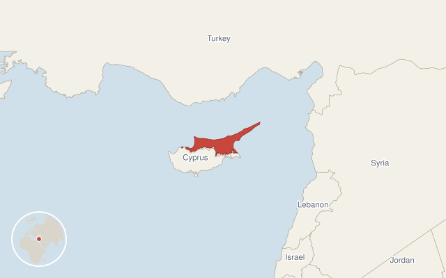

---
id    = "f247f847-7619-516d-bd82-f8cb2ddf133f"
model = "Basic"
tags  = ["asia", "mediterranean", "middle_east", "sovereign_state", "flag"]
---

## Front

Whose flag is this?

## Back

<b>Northern Cyprus</b>

## Extra

Adopted in 1984, drawn by the Turkish Cypriot artist Emin Çizenel

Based on the flag of Turkey with the colours reversed, plus a red stripe at top and bottom. There is no official statement on its meaning; one reading is that the top stripe stands for Turkey and the bottom for Northern Cyprus.

State recognised only by Turkey and claimed by Cyprus.

<a href="https://en.wikipedia.org/wiki/Flag_of_Northern_Cyprus">Flag of Northern Cyprus on Wikipedia</a> <a href="https://en.wikipedia.org/wiki/Northern_Cyprus">Northern Cyprus on Wikipedia</a>
