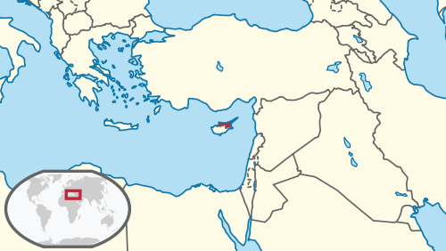

---
id    = "9bba29f3-689a-5848-9202-2cfd8af0295a"
model = "Basic"
tags  = ["asia", "mediterranean", "middle_east", "sovereign_state", "map"]
---

## Front

What is highlighted on this map?

## Back

<b>Northern Cyprus</b>

## Extra

State recognised only by Turkey and claimed by Cyprus.
