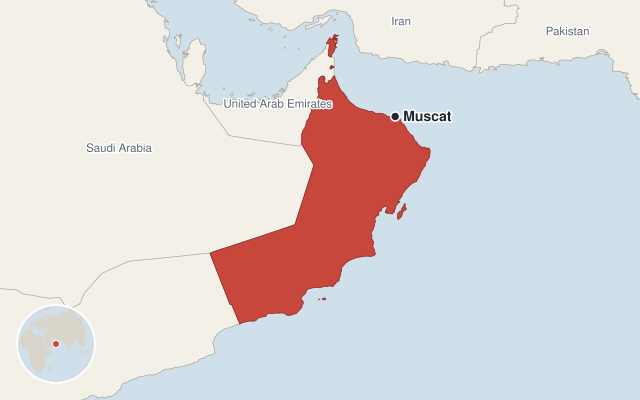

---
id    = "0df5d83c-9244-5778-a662-21e127c508c1"
model = "Basic"
tags  = ["asia", "middle_east", "sovereign_state", "capital"]
---

## Front

What is the capital of <b>Oman</b>?

## Back

<b>Muscat</b>

## Extra

<i>Photo: Leon petrosyan, CC BY-SA 4.0, via Wikimedia Commons</i>

About 1.72 million people in the Muscat Governorate (2022) On the Gulf of Oman, below the Hajar Mountains

Known since the early 1st century CE as a leading port for trade between the west and the east. The water off the coast runs deep, forming two natural harbours, at Muttrah and Muscat.

<a href="https://en.wikipedia.org/wiki/Muscat">Muscat on Wikipedia</a> <a href="https://en.wikipedia.org/wiki/Oman">Oman on Wikipedia</a>
