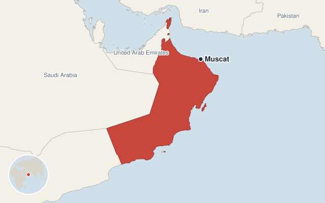
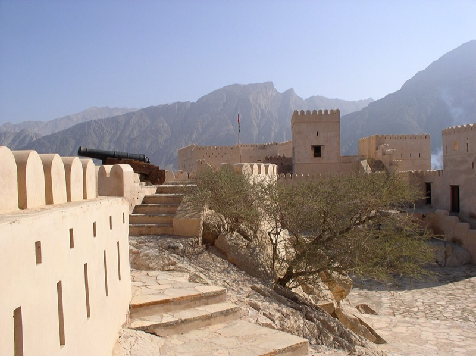

---
id    = "6a54d318-df2b-55d5-908b-f3b260cfa319"
model = "Basic"
tags  = ["asia", "middle_east", "sovereign_state", "country"]
---

## Front

<b>Muscat</b> is the capital of which country or territory?

## Back

<b>Oman</b>

## Extra

<i>Photo: Sakralamn, CC BY-SA 4.0, via Wikimedia Commons</i>

About 5.1 million people (2026) Third-largest country on the Arabian Peninsula

Ruled continuously by the Al Bu Said dynasty since 1744. In the 19th century its influence reached across the Strait of Hormuz to what later became Iran and Pakistan, and south to Zanzibar.

<a href="https://en.wikipedia.org/wiki/Oman">Oman on Wikipedia</a> <a href="https://en.wikipedia.org/wiki/Muscat">Muscat on Wikipedia</a>
