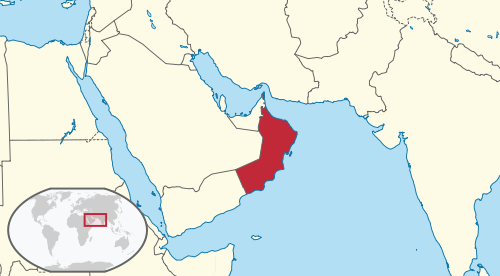
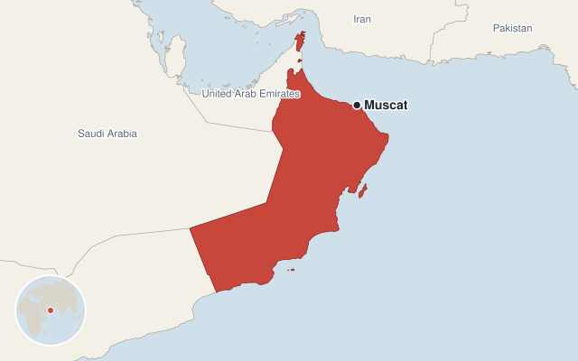

---
id    = "2e524c6b-efa6-5401-826d-47fdb16bd7bf"
model = "Basic"
tags  = ["asia", "middle_east", "sovereign_state", "map"]
---

## Front

What is highlighted on this map?

## Back

<b>Oman</b>

## Extra

<a href="https://en.wikipedia.org/wiki/Oman">Oman on Wikipedia</a>
