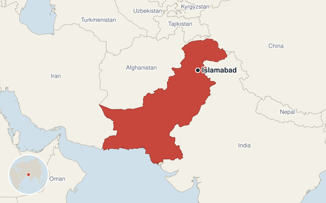
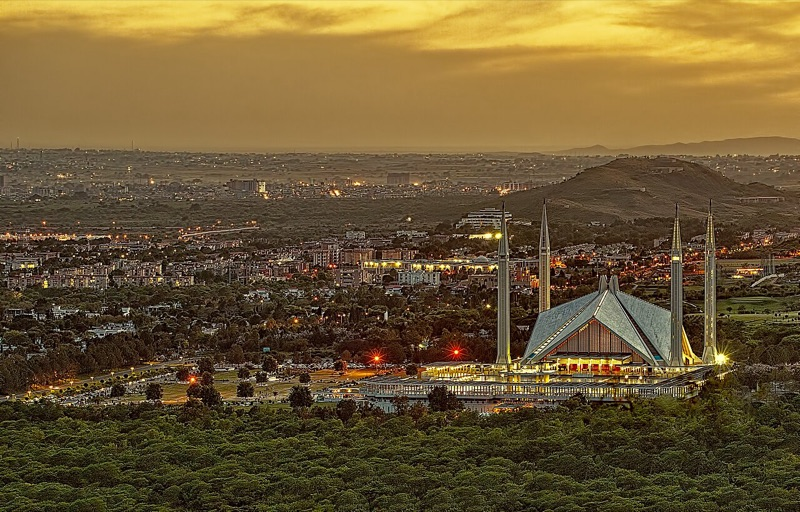

---
id    = "59ac4f86-43b5-5595-9a47-acf5bbc9c140"
model = "Basic"
tags  = ["asia", "sovereign_state", "capital"]
---

## Front

What is the capital of <b>Pakistan</b>?

## Back

<b>Islamabad</b>

## Extra

<i>Photo: Tahsin Shah, CC BY-SA 4.0, via Wikimedia Commons</i>

About 1.01 million people (2017) 490 m up, along the Margalla Hills

A planned city, established in 1967 to replace Karachi as the capital. The Greek architect Constantinos Apostolou Doxiadis drew the master plan and divided it into eight zones.

<a href="https://en.wikipedia.org/wiki/Islamabad">Islamabad on Wikipedia</a> <a href="https://en.wikipedia.org/wiki/Pakistan">Pakistan on Wikipedia</a>
