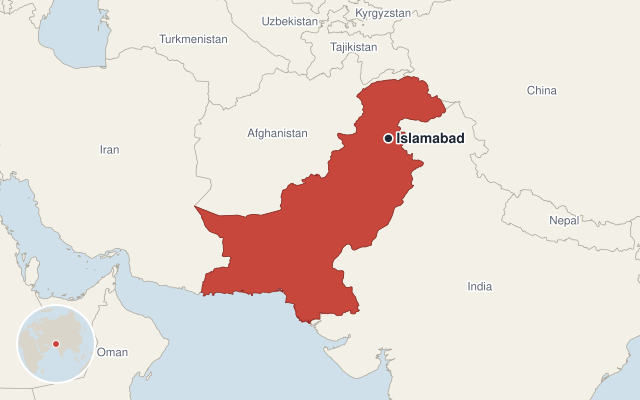

---
id    = "6f8c1553-25b3-5ab2-a64d-ed987e3300a6"
model = "Basic"
tags  = ["asia", "sovereign_state", "country"]
---

## Front

<b>Islamabad</b> is the capital of which country or territory?

## Back

<b>Pakistan</b>

## Extra

<a href="https://en.wikipedia.org/wiki/Pakistan">Pakistan on Wikipedia</a> <a href="https://en.wikipedia.org/wiki/Islamabad">Islamabad on Wikipedia</a>
