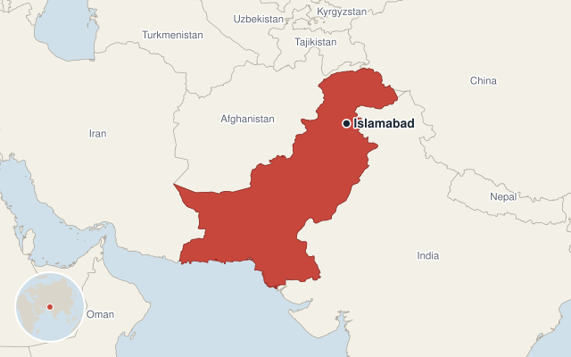

---
id    = "ab236d47-da2b-5825-8e7e-dbb4552d1712"
model = "Basic"
tags  = ["asia", "sovereign_state", "flag"]
---

## Front

Whose flag is this?

## Back

<b>Pakistan</b>

## Extra

<a href="https://en.wikipedia.org/wiki/Flag_of_Pakistan">Flag of Pakistan on Wikipedia</a> <a href="https://en.wikipedia.org/wiki/Pakistan">Pakistan on Wikipedia</a>
