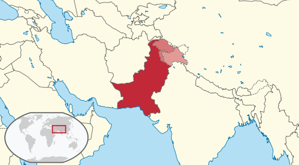
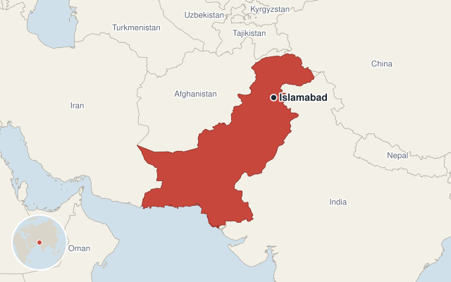

---
id    = "bbc615ac-7a6c-56e9-b905-cec48cdcdb03"
model = "Basic"
tags  = ["asia", "sovereign_state", "map"]
---

## Front

What is highlighted on this map?

## Back

<b>Pakistan</b>

## Extra

Borders India, Afghanistan, Iran and China Area of about 882,000 km²

Afghanistan's narrow Wakhan Corridor separates Pakistan from Tajikistan in the northwest. The Arabian Sea lies to the south and the Gulf of Oman to the southwest.

<a href="https://en.wikipedia.org/wiki/Pakistan">Pakistan on Wikipedia</a>
