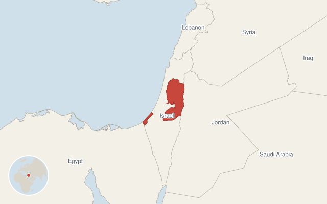
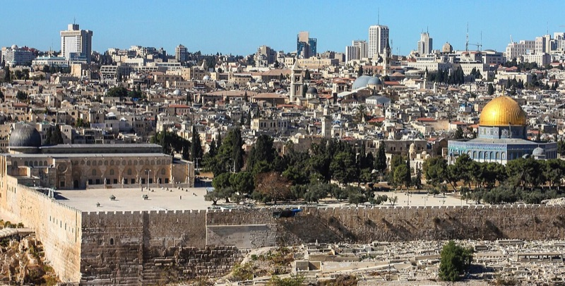

---
id    = "0ca193b2-16a0-5ea8-a8c1-237782f77d80"
model = "Basic"
tags  = ["asia", "mediterranean", "middle_east", "sovereign_state", "capital"]
---

## Front

What is the capital of <b>Palestine</b>?

<i>Claimed but not controlled</i>

## Back

<b>Jerusalem</b>

## Extra

<i>Photo: askii, CC BY-SA 2.0, via Wikimedia Commons</i>

About 1.05 million people (2024) 754 m up, on a plateau in the Judaean Mountains

Holy to Judaism, Christianity and Islam, and one of the oldest cities in the world. Both Israel and Palestine claim it as their capital; neither claim is widely recognised internationally.

Disputed; claimed by Israel; Ramallah is the administrative centre.

<a href="https://en.wikipedia.org/wiki/Jerusalem">Jerusalem on Wikipedia</a> <a href="https://en.wikipedia.org/wiki/State_of_Palestine">State of Palestine on Wikipedia</a>
