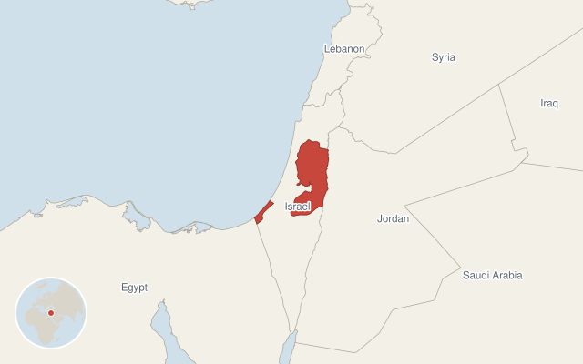

---
id    = "506a08a3-d02f-5b73-a288-414350d2addf"
model = "Basic"
tags  = ["asia", "mediterranean", "middle_east", "sovereign_state", "country"]
---

## Front

<b>Jerusalem</b> is the capital of which country or territory?

## Back

<b>Palestine</b>

## Extra

Disputed; claimed by Israel; Ramallah is the administrative centre.

<a href="https://en.wikipedia.org/wiki/State_of_Palestine">State of Palestine on Wikipedia</a> <a href="https://en.wikipedia.org/wiki/Jerusalem">Jerusalem on Wikipedia</a>
