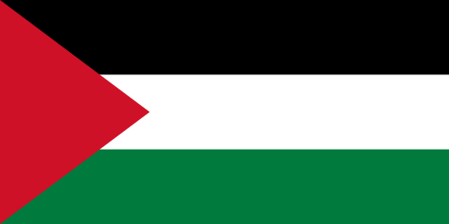

---
id    = "a8f3db09-d328-53e9-9059-e0d5d41eac41"
model = "Basic"
tags  = ["asia", "mediterranean", "middle_east", "sovereign_state", "flag"]
---

## Front

Whose flag is this?

## Back

<b>Palestine</b>

## Extra

Similar flags: Sudan (red/white/black, green arrow), Sahrawi Arab Democratic Republic (with star and crescent)
