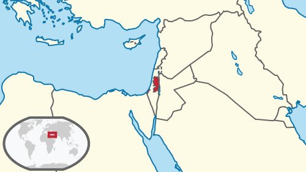
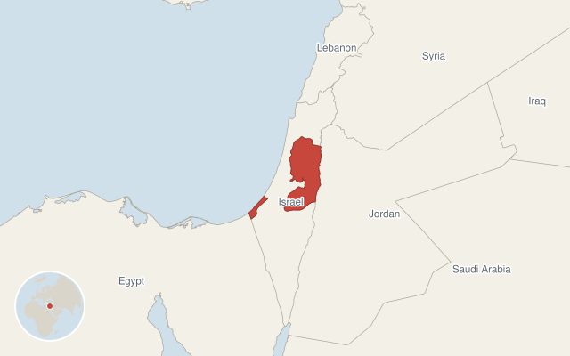

---
id    = "f875f91b-9361-501e-8590-cb09b61bc001"
model = "Basic"
tags  = ["asia", "mediterranean", "middle_east", "sovereign_state", "map"]
---

## Front

What is highlighted on this map?

## Back

<b>Palestine</b>

## Extra

Borders Israel, Jordan and Egypt Area of about 6,020 km²

Two separate territories: the West Bank, which borders Jordan to the east, and the Gaza Strip, which borders Egypt to the southwest.

<a href="https://en.wikipedia.org/wiki/State_of_Palestine">State of Palestine on Wikipedia</a>
