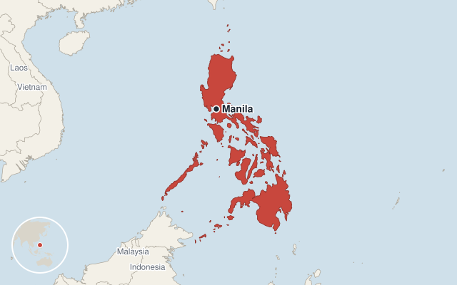

---
id    = "363c86a5-1f74-5f63-8a58-092b9f2c892d"
model = "Basic"
tags  = ["asia", "southeast_asia", "sovereign_state", "capital"]
---

## Front

What is the capital of <b>Philippines</b>?

## Back

<b>Manila</b>

## Extra

<a href="https://en.wikipedia.org/wiki/Manila">Manila on Wikipedia</a> <a href="https://en.wikipedia.org/wiki/Philippines">Philippines on Wikipedia</a>
