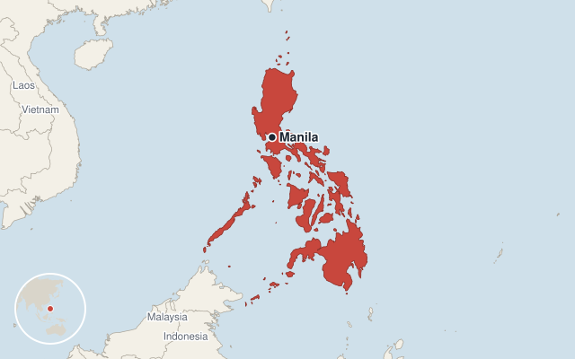

---
id    = "124b6841-f878-5318-8ab1-12a773965403"
model = "Basic"
tags  = ["asia", "southeast_asia", "sovereign_state", "country"]
---

## Front

<b>Manila</b> is the capital of which country or territory?

## Back

<b>Philippines</b>

## Extra

About 113 million people (2024) Independent since 1946

Spanish explorer Ruy López de Villalobos named the islands las Islas Filipinas in 1543, in honor of King Philip II.

<a href="https://en.wikipedia.org/wiki/Philippines">Philippines on Wikipedia</a> <a href="https://en.wikipedia.org/wiki/Manila">Manila on Wikipedia</a>
