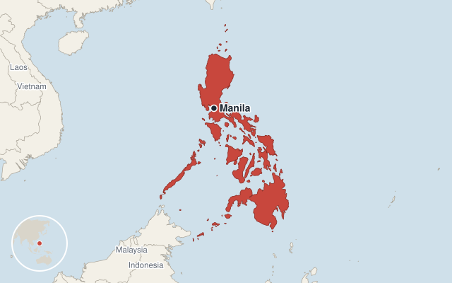

---
id    = "dd8461c5-87fc-5ed5-bdad-f5f210317f5d"
model = "Basic"
tags  = ["asia", "southeast_asia", "sovereign_state", "flag"]
---

## Front

Whose flag is this?

## Back

<b>Philippines</b>

## Extra

<a href="https://en.wikipedia.org/wiki/Flag_of_the_Philippines">Flag of the Philippines on Wikipedia</a> <a href="https://en.wikipedia.org/wiki/Philippines">Philippines on Wikipedia</a>
