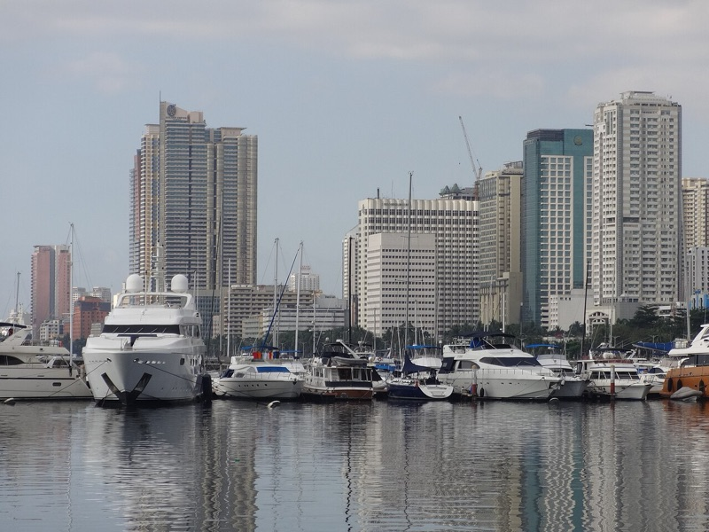

---
id    = "49a583c4-acf4-5549-b196-836434fa8ea9"
model = "Basic"
tags  = ["asia", "southeast_asia", "sovereign_state", "map"]
---

## Front

What is highlighted on this map?

## Back

<b>Philippines</b>

## Extra

<i>Photo: Patrick Roque, CC BY-SA 4.0, via Wikimedia Commons</i>

About 7,641 islands, in three main groups: Luzon, Visayas and Mindanao Highest point: Mount Apo

Bounded by the South China Sea to the west, the Philippine Sea to the east and the Celebes Sea to the south.

<a href="https://en.wikipedia.org/wiki/Philippines">Philippines on Wikipedia</a>
