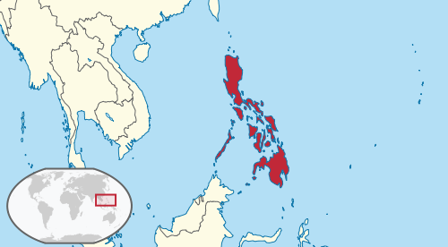
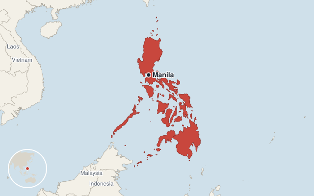

---
id    = "49a583c4-acf4-5549-b196-836434fa8ea9"
model = "Basic"
tags  = ["asia", "southeast_asia", "sovereign_state", "map"]
---

## Front

What is highlighted on this map?

## Back

<b>Philippines</b>

## Extra

<a href="https://en.wikipedia.org/wiki/Philippines">Philippines on Wikipedia</a>
