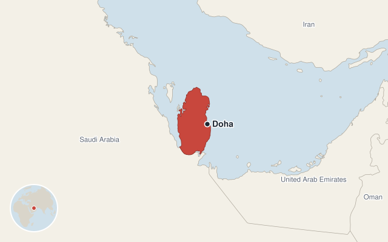

---
id    = "09d39ffb-318f-52fb-a268-e362401f2380"
model = "Basic"
tags  = ["asia", "middle_east", "sovereign_state", "capital"]
---

## Front

What is the capital of <b>Qatar</b>?

## Back

<b>Doha</b>

## Extra

About 1.19 million people (2020) On the Persian Gulf coast, in the east of the country

Founded in the 1820s as an offshoot of Al Bidda, and declared the capital in 1971 when Qatar became independent of Britain. Over 80% of the nation lives in Doha or its suburbs.

<a href="https://en.wikipedia.org/wiki/Doha">Doha on Wikipedia</a> <a href="https://en.wikipedia.org/wiki/Qatar">Qatar on Wikipedia</a>
