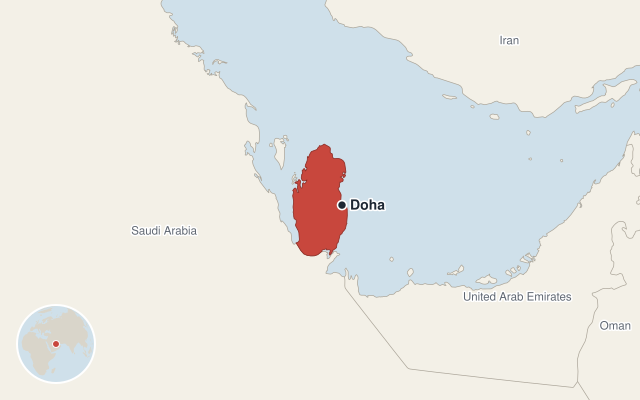

---
id    = "5d7d621a-efff-5ddd-adc8-391726255502"
model = "Basic"
tags  = ["asia", "middle_east", "sovereign_state", "country"]
---

## Front

<b>Doha</b> is the capital of which country or territory?

## Back

<b>Qatar</b>

## Extra

<a href="https://en.wikipedia.org/wiki/Qatar">Qatar on Wikipedia</a> <a href="https://en.wikipedia.org/wiki/Doha">Doha on Wikipedia</a>
