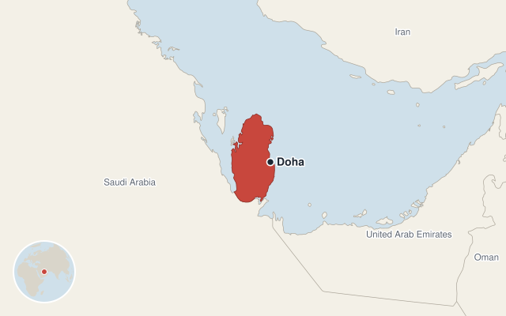
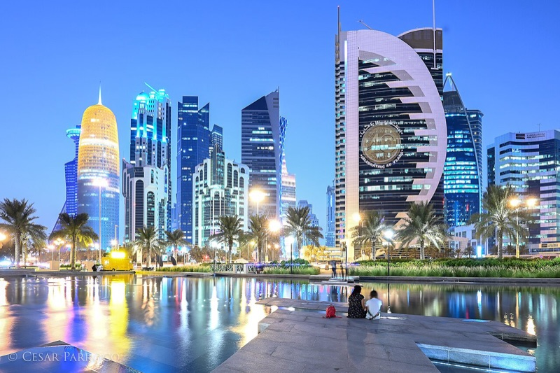

---
id    = "fe43072f-5fad-5c6b-b6c5-6cfaf7c941ad"
model = "Basic"
tags  = ["asia", "middle_east", "sovereign_state", "map"]
---

## Front

What is highlighted on this map?

## Back

<b>Qatar</b>

## Extra

<i>Photo: Ceslou, CC BY-SA 4.0, via Wikimedia Commons</i>

Occupies the Qatar Peninsula, with its only land border with Saudi Arabia Area of about 11,437 km²

Most of the land is flat, low-lying desert. The Gulf of Bahrain, an inlet of the Persian Gulf, separates Qatar from nearby Bahrain.

<a href="https://en.wikipedia.org/wiki/Qatar">Qatar on Wikipedia</a>
