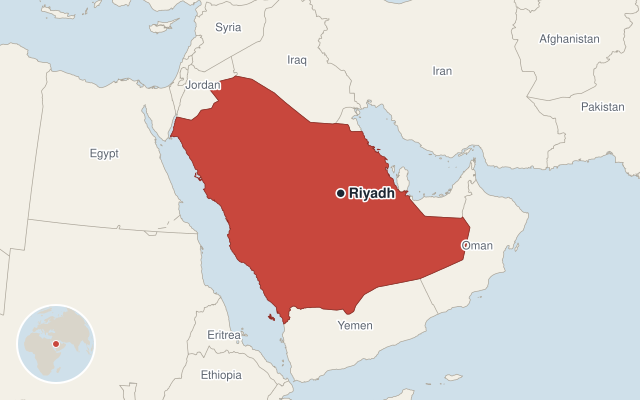

---
id    = "a8468336-2e02-52cd-8c96-46a69c0a168c"
model = "Basic"
tags  = ["asia", "middle_east", "sovereign_state", "capital"]
---

## Front

What is the capital of <b>Saudi Arabia</b>?

## Back

<b>Riyadh</b>

## Extra

About 7 million people (2022) About 612 m up, on the Najd plateau

The largest city on the Arabian Peninsula. The current city largely emerged in the 1950s as an expansion of the 18th-century walled town, after its defensive fortifications were dismantled.

<a href="https://en.wikipedia.org/wiki/Riyadh">Riyadh on Wikipedia</a> <a href="https://en.wikipedia.org/wiki/Saudi_Arabia">Saudi Arabia on Wikipedia</a>
