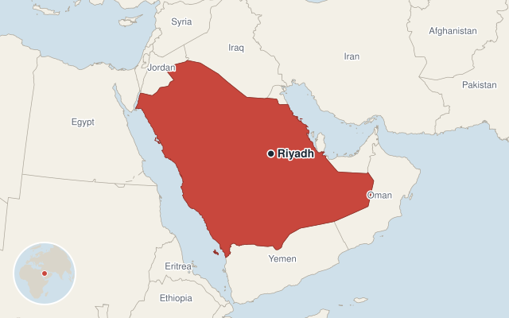

---
id    = "8bec8e24-3d5b-5251-831d-b106b82b2457"
model = "Basic"
tags  = ["asia", "middle_east", "sovereign_state", "country"]
---

## Front

<b>Riyadh</b> is the capital of which country or territory?

## Back

<b>Saudi Arabia</b>

## Extra

About 33 million people (2018) Fifth-largest country in Asia

Occupies the bulk of the Arabian Peninsula. Islam emerged here in the early seventh century, and the country holds the two holiest cities in Islam, Mecca and Medina.

<a href="https://en.wikipedia.org/wiki/Saudi_Arabia">Saudi Arabia on Wikipedia</a> <a href="https://en.wikipedia.org/wiki/Riyadh">Riyadh on Wikipedia</a>
