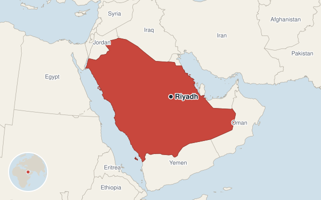

---
id    = "d2deff6a-6282-5958-8590-d99d388321dc"
model = "Basic"
tags  = ["asia", "middle_east", "sovereign_state", "flag"]
---

## Front

Whose flag is this?

## Back

<b>Saudi Arabia</b>

## Extra

<a href="https://en.wikipedia.org/wiki/Flag_of_Saudi_Arabia">Flag of Saudi Arabia on Wikipedia</a> <a href="https://en.wikipedia.org/wiki/Saudi_Arabia">Saudi Arabia on Wikipedia</a>
