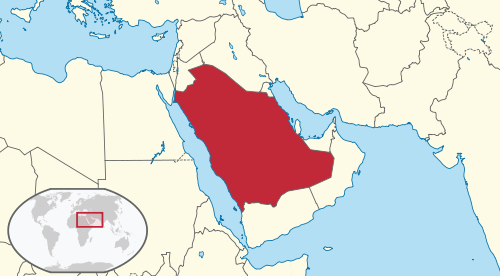
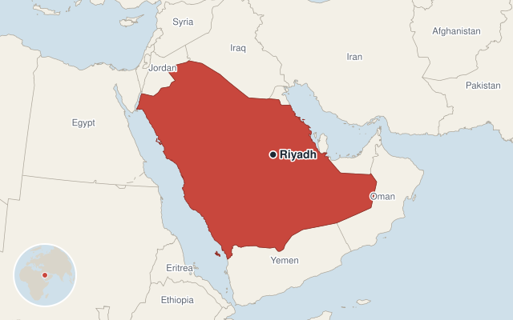

---
id    = "b64f4aa9-3fc3-5210-a2ad-85773af53dbe"
model = "Basic"
tags  = ["asia", "middle_east", "sovereign_state", "map"]
---

## Front

What is highlighted on this map?

## Back

<b>Saudi Arabia</b>

## Extra

Land area of about 2.15 million km² Borders Jordan, Iraq and Kuwait to the north and Yemen to the south

The Red Sea lies to the west and the Persian Gulf to the east. The Gulf of Aqaba in the northwest separates the country from Egypt and Israel.

<a href="https://en.wikipedia.org/wiki/Saudi_Arabia">Saudi Arabia on Wikipedia</a>
