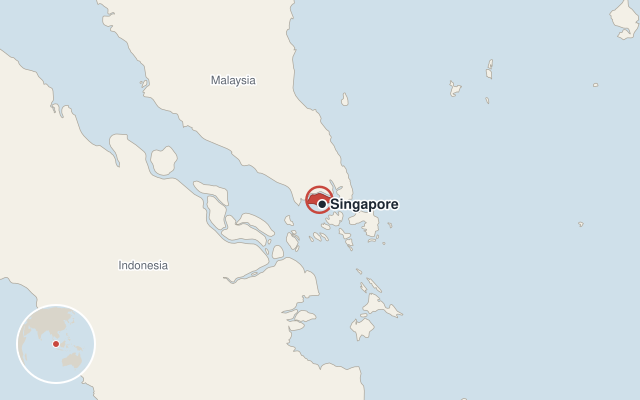

---
id    = "c0dfe564-665b-5531-b6e8-1be50f98e395"
model = "Basic"
tags  = ["asia", "southeast_asia", "sovereign_state", "capital"]
---

## Front

What is the capital of <b>Singapore</b>?

## Back

<b>Singapore</b>

## Extra

<a href="https://en.wikipedia.org/wiki/Singapore">Singapore on Wikipedia</a>
