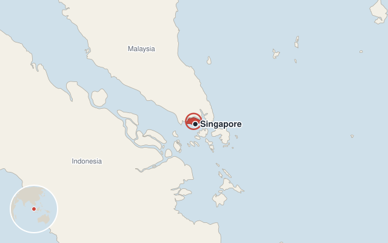

---
id    = "d3e8b9fc-a95b-5288-a2a7-648b76e42add"
model = "Basic"
tags  = ["asia", "southeast_asia", "sovereign_state", "country"]
---

## Front

<b>Singapore</b> is the capital of which country or territory?

## Back

<b>Singapore</b>

## Extra

Independent from Malaysia on 9 August 1965 Island country and city-state

Under direct British control from 1867 as part of the Straits Settlements. It was occupied by Japan in 1942 and returned to Britain as a Crown colony in 1945.

<a href="https://en.wikipedia.org/wiki/Singapore">Singapore on Wikipedia</a>
