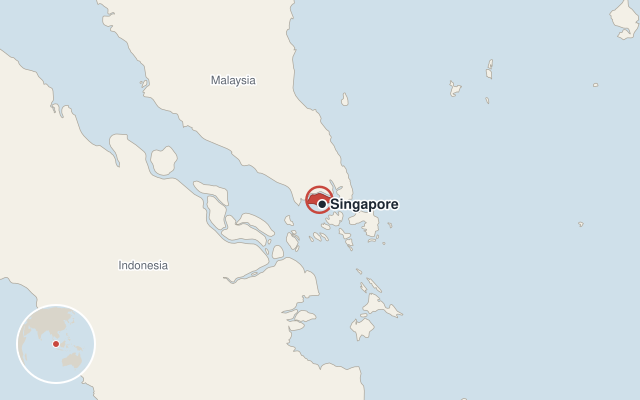

---
id    = "3a232837-05e6-58d9-bdf3-0a5742b775a4"
model = "Basic"
tags  = ["asia", "southeast_asia", "sovereign_state", "flag"]
---

## Front

Whose flag is this?

## Back

<b>Singapore</b>

## Extra

Adopted in 1959, the year Singapore became self-governing

Red above white, with a white crescent and five small white stars in the upper hoist corner. The elements denote a young nation on the ascendant, universal brotherhood and equality, and national ideals.

<a href="https://en.wikipedia.org/wiki/Flag_of_Singapore">Flag of Singapore on Wikipedia</a> <a href="https://en.wikipedia.org/wiki/Singapore">Singapore on Wikipedia</a>
