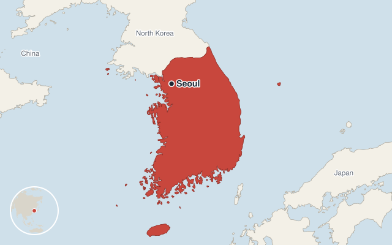

---
id    = "931b2f73-ca66-5e4b-ae38-175f029c888a"
model = "Basic"
tags  = ["asia", "sovereign_state", "capital"]
---

## Front

What is the capital of <b>South Korea</b>?

## Back

<b>Seoul</b>

## Extra

<a href="https://en.wikipedia.org/wiki/Seoul">Seoul on Wikipedia</a> <a href="https://en.wikipedia.org/wiki/South_Korea">South Korea on Wikipedia</a>
