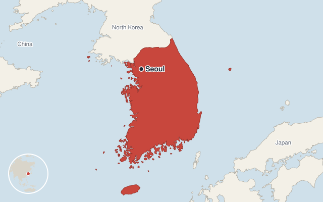

---
id    = "63acbde8-d8ff-52a8-b545-89bb83010148"
model = "Basic"
tags  = ["asia", "sovereign_state", "country"]
---

## Front

<b>Seoul</b> is the capital of which country or territory?

## Back

<b>South Korea</b>

## Extra

<a href="https://en.wikipedia.org/wiki/South_Korea">South Korea on Wikipedia</a> <a href="https://en.wikipedia.org/wiki/Seoul">Seoul on Wikipedia</a>
