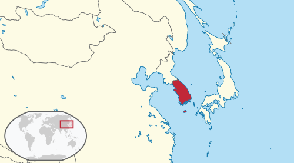
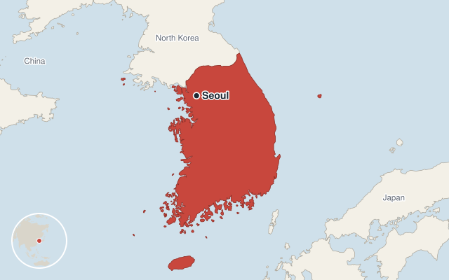

---
id    = "295d50a4-ebad-55e3-9c02-18f85611309c"
model = "Basic"
tags  = ["asia", "sovereign_state", "map"]
---

## Front

What is highlighted on this map?

## Back

<b>South Korea</b>

## Extra

<a href="https://en.wikipedia.org/wiki/South_Korea">South Korea on Wikipedia</a>
