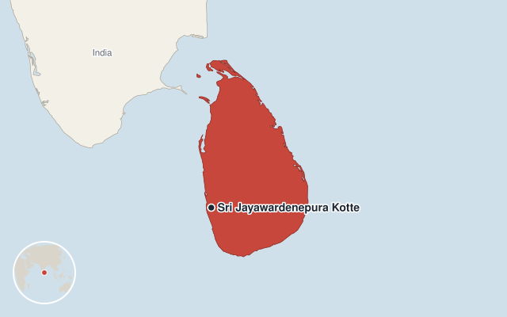
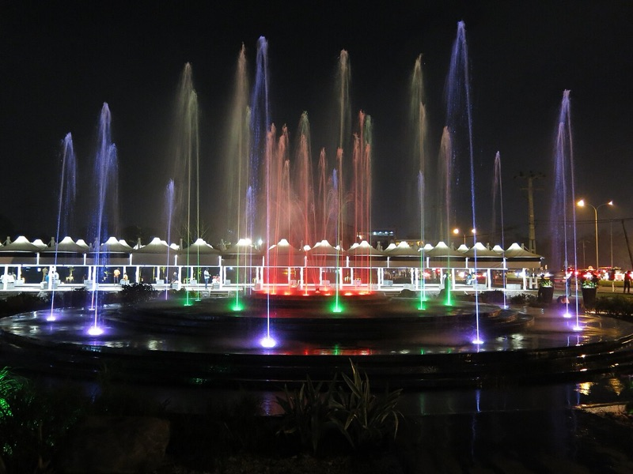

---
id    = "4356255b-4807-59aa-a685-ce97960dc226"
model = "Basic"
tags  = ["asia", "sovereign_state", "capital"]
---

## Front

What is the capital of <b>Sri Lanka</b>?

## Back

<b>Sri Jayawardenepura Kotte</b>

## Extra

<i>Photo: Hansa Nanayakkara, CC BY-SA 3.0, via Wikimedia Commons</i>

About 116,000 people (2025) Next to Colombo, the largest city

The legislative capital of Sri Lanka. In the 13th century a local chieftain, Nissanka Alagakkonara, built a Kotte, or fortress, on a naturally secure site at the meeting of two streams.

Colombo is often referred to as the capital but Sri Jayawardenepura Kotte, a suburb of Colombo, is the official, legislative capital.

<a href="https://en.wikipedia.org/wiki/Sri_Jayawardenepura_Kotte">Sri Jayawardenepura Kotte on Wikipedia</a> <a href="https://en.wikipedia.org/wiki/Sri_Lanka">Sri Lanka on Wikipedia</a>
