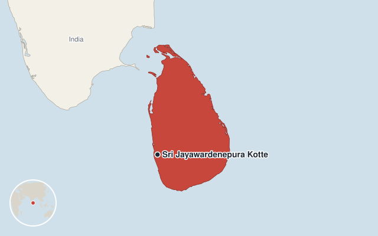

---
id    = "d4c7a962-ffc0-56b7-ae4f-311cdce38667"
model = "Basic"
tags  = ["asia", "sovereign_state", "country"]
---

## Front

<b>Sri Jayawardenepura Kotte</b> is the capital of which country or territory?

## Back

<b>Sri Lanka</b>

## Extra

Colombo is often referred to as the capital but Sri Jayawardenepura Kotte, a suburb of Colombo, is the official, legislative capital.

<a href="https://en.wikipedia.org/wiki/Sri_Lanka">Sri Lanka on Wikipedia</a> <a href="https://en.wikipedia.org/wiki/Sri_Jayawardenepura_Kotte">Sri Jayawardenepura Kotte on Wikipedia</a>
