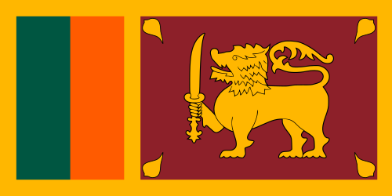
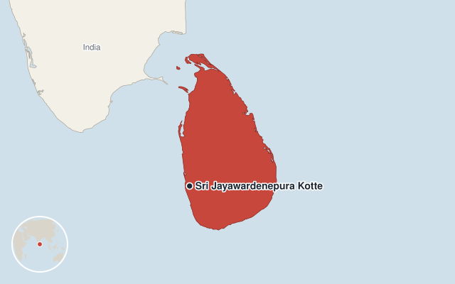

---
id    = "ca92036b-69a2-5a9d-bc68-79123aea80be"
model = "Basic"
tags  = ["asia", "sovereign_state", "flag"]
---

## Front

Whose flag is this?

## Back

<b>Sri Lanka</b>

## Extra

Dates from 1972

A golden lion on maroon, with a teal stripe and an orange stripe. The lion and maroon represent the Sinhalese, the orange stripe the Tamils, and the green stripe the Sri Lankan Moors.

<a href="https://en.wikipedia.org/wiki/Flag_of_Sri_Lanka">Flag of Sri Lanka on Wikipedia</a> <a href="https://en.wikipedia.org/wiki/Sri_Lanka">Sri Lanka on Wikipedia</a>
