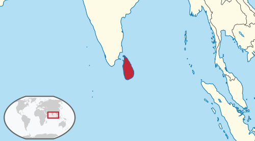
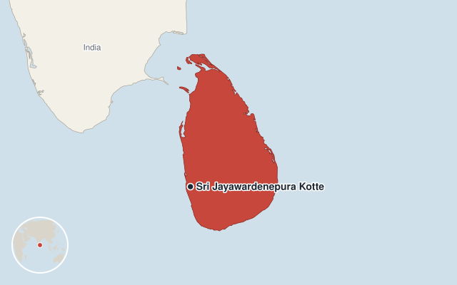

---
id    = "fa3fa037-0696-5946-ba67-ee50c31183a9"
model = "Basic"
tags  = ["asia", "sovereign_state", "map"]
---

## Front

What is highlighted on this map?

## Back

<b>Sri Lanka</b>

## Extra

Area of about 65,610 km² Highest point: Pidurutalagala

An island in the Indian Ocean, southwest of the Bay of Bengal. The Gulf of Mannar and the Palk Strait separate it from India.

<a href="https://en.wikipedia.org/wiki/Sri_Lanka">Sri Lanka on Wikipedia</a>
