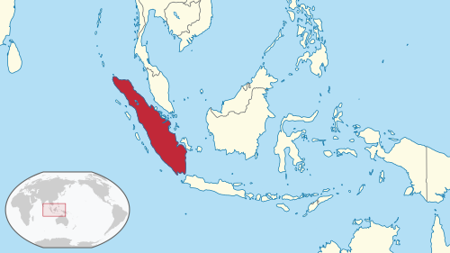

---
id    = "d255e73f-159b-5801-93c6-cee7041488d8"
model = "Basic"
tags  = ["asia", "map"]
---

## Front

What is highlighted on this map?

## Back

<b>Sumatra</b>

## Extra

Sixth-largest island in the world About 60 million people (2021)

An elongated landmass on a northwest to southeast axis, with the equator crossing its centre. The narrow Strait of Malacca separates it from the Malay Peninsula.

Island of Indonesia.

<a href="https://en.wikipedia.org/wiki/Sumatra">Sumatra on Wikipedia</a>
